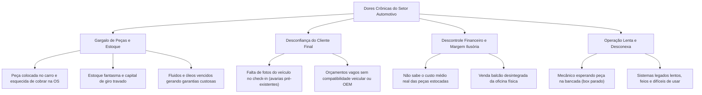

# 🚗 VORTEX AUTO — Plataforma Integrada de Gestão Automotiva (ERP, WMS & BI)

**Documento Executivo de Apresentação, Guia de Treinamento e Alinhamento Comercial**  
*Versão 1.0 — Produção*  
*Ambiente Oficial:* `https://www.vortexauto.com.br`

---

## 📌 Sumário Executivo

O **Vortex Auto** foi concebido para transformar a operação, rentabilidade e governança de centros automotivos, oficinas mecânicas especializadas, auto centers, convertedoras e funilarias.

Diferente de sistemas legados genéricos ou planilhas descentralizadas, o Vortex Auto unifica em uma única interface web moderna e de alta velocidade:
1. **Recepção e Check-in Digital com Laudo Fotográfico**;
2. **Ordens de Serviço com Kanban de Box e Controle de Tempo**;
3. **WMS Automotivo com Leitor de Código de Barras / QR Code**;
4. **Módulo de Compras com MRP e Custo Médio Ponderado (CMP)**;
5. **Frente de Caixa e Venda Balcão Integrada**;
6. **Business Intelligence (BI) e Relatórios de Margem Real**.

---

## 🔍 O Cenário de Mercado e as Dores das Oficinas

O mercado de pós-venda e reparação automotiva no Brasil movimenta dezenas de bilhões de reais por ano, porém sofre de **ineficiências crônicas** que corroem as margens de lucro dos proprietários de oficinas:

### Principais Dores Solucionadas:

1. **"A peça sumiu ou foi aplicada sem cobrança":**  
   Em oficinas tradicionais, mecânicos pegam peças no almoxarifado sem apontamento imediato. No fechamento da OS, a peça é esquecida e o prejuízo fica com a oficina.  
   *Solução Vortex:* **WMS com Bipagem Obrigatória**. Nenhuma peça sai do estoque sem bipar e vincular à OS ou Venda Balcão.

2. **Capital de Giro Parado x Box Ocioso:**  
   Ou a oficina compra peças em excesso que ficam meses paradas, ou o carro fica desmontado no elevador esperando dias por uma peça básica (filtro, vela, pastilha).  
   *Solução Vortex:* **MRP Automotivo**. O sistema analisa o estoque mínimo e as peças reservadas em orçamentos aprovados, gerando ordens de compra automáticas com base na demanda real.

3. **Custo Médio Desatualizado e Preço de Venda Errado:**  
   Com a inflação de autopeças, comprar a mesma peça por valores diferentes faz com que o dono cobre um preço desatualizado, perdendo margem.  
   *Solução Vortex:* **Cálculo Automático de Custo Médio Ponderado (CMP)** em cada entrada de nota, garantindo margem de lucro saudável e previsível.

4. **Litígios de Avarias e Transparência:**  
   Clientes que alegam que o carro entrou sem um arranhão ou com componentes que já estavam danificados.  
   *Solução Vortex:* **Checklist Digital com Anexos Fotográficos** no momento exato em que o veículo chega na oficina.

---

## 🏛️ Arquitetura e Engenharia da Solução

O Vortex Auto foi construído seguindo as melhores práticas globais de engenharia de software (Clean Architecture, Multi-Tenant nativo e Containerização):

* **Backend:** Node.js 22 LTS de alta performance com Fastify e TypeScript estrito.
* **ORM e Dados:** Prisma ORM com PostgreSQL 17 relacional, garantindo integridade transacional ACID em estoques e finanças.
* **Frontend:** React SPA ultra-responsivo com Vite, desenhado em **Vanilla CSS** moderno (Dark Mode Premium Glassmorphism), proporcionando máxima fluidez visual sem engasgos em tablets, notebooks e desktops.
* **Infraestrutura:** Docker Multi-Stage isolado em rede interna privativa, servido sob Nginx com compressão Gzip e tráfego HTTPS criptografado de ponta a ponta.

---

## 📦 Módulos da Aplicação — Guia de Funcionalidades

### 1. Recepção, Clientes, Veículos e Atendimentos
* **Histórico Vital do Veículo:** Consulta por placa ou chassi com exibição de todas as manutenções, peças trocadas e garantias anteriores.
* **Checklist de Entrada:** Registro de nível de combustível, quilometragem atual, estado dos pneus, estepe, macaco e **fotos de avarias pré-existentes**.
* **Dupla Barra de Rolagem Sincronizada:** Interface com scroll superior e inferior inteligentes para manuseio ergonômico de tabelas extensas.

### 2. Quadro Kanban Operacional (Gestão de Box)
* Visão dinâmica por colunas de status:  
  `Recepção` ➔ `Diagnóstico Técnico` ➔ `Orçamento` ➔ `Aguardando Aprovação` ➔ `Em Execução` ➔ `Controle de Qualidade` ➔ `Pronto para Entrega` ➔ `Finalizado`.
* Cada card exibe veículo, placa, cliente, valor atual da OS e mecânico responsável, com scroll vertical independente por coluna.

### 3. WMS Automotivo (Warehouse Management System)
* **Bipagem por Código de Barras / QR Code:**
  * **Entrada de Mercadoria:** Bipagem para conferência de compras e entrada no saldo físico.
  * **Saída para OS:** Baixa com um clique ou bipe direto na Ordem de Serviço em execução.
  * **Saída Balcão:** Baixa instantânea na venda rápida.
* **Ficha Técnica & Modal de Peça:**
  * Marca, modelo, código do fabricante e código OEM.
  * **Compatibilidade Veicular:** Especificação de modelos/anos em que a peça pode ser instalada (ex: *Ford Ka / Fiesta 1.0 e 1.6 RoCam*).
  * **Controle de Validade e Lote:** Indispensável para óleos sintéticos, fluidos de freio DOT 4/5.1 e aditivos de radiador.
  * **Galeria Fotográfica:** Clique na imagem do produto para abrir a Ficha Técnica Completa em modal glassmorphism de alta resolução.

### 4. Módulo de Compras & MRP (Material Requirement Planning)
* **Sugestão Inteligente de Reposição:**
  * O sistema varre todos os itens cujo `Saldo Físico - Reservado <= Estoque Mínimo`.
  * Cruza com as peças demandadas por ordens de serviço recém-aprovadas.
  * Gera lista de sugestão com quantidade a comprar, fornecedor preferencial e estimativa de investimento.
* **Gestão de Fornecedores e Notas:**
  * Histórico de pedidos de compra (Cotação, Confirmado, Recebido).
  * Entrada com atualização automática de **Custo Médio Ponderado** e atualização do último preço de compra.

### 5. Frente de Caixa & Vendas Balcão
* Atendimento a clientes externos (venda de óleo, palhetas, lâmpadas ou aditivos no balcão da oficina).
* Seleção de itens via bipagem ou busca por nome/OEM.
* Baixa em tempo real no estoque físico e geração automática do lançamento financeiro.
* Recurso de **Cancelamento com Estorno Automático**: Se a venda for desfeita, o estoque retorna imediatamente à prateleira com registro em log de auditoria.

### 6. Relatórios Gerenciais & Business Intelligence (BI)
* **Cards de Indicadores Chave (KPIs):** Faturamento Total, Ticket Médio por Veículo, Taxa de Conversão de Orçamentos e Peças Críticas em Falta.
* **Curva ABC de Peças e Serviços:** Identificação de 20% dos itens que representam 80% do lucro da oficina.
* **Exportação Dinâmica:** Geração de relatórios operacionais e financeiros em formato CSV/Excel para contabilidade e auditoria externa.

---

## 🛠️ Casos de Uso Práticos (Passo a Passo)

### Caso 1: Ciclo Completo de Atendimento na Oficina
1. **Recepção:** O cliente chega na oficina com um ruído na suspensão. O recepcionista abre a tela de Atendimentos, digita a placa e seleciona o cliente. Realiza o checklist com quilometragem e anexa foto da avaria no para-choque.
2. **Diagnóstico:** O veículo move-se para a coluna "Diagnóstico" no Kanban. O mecânico inspeciona e aponta a necessidade de troca dos 2 amortecedores dianteiros e bieletas.
3. **Orçamento & Aprovação:** O orçamentista lança as peças e mão de obra. O sistema calcula a margem. O cliente aprova via WhatsApp/presencial. O status muda para "Aprovado" e as peças ficam automaticamente **reservadas** no estoque.
4. **Separação WMS:** O mecânico vai ao almoxarifado, bipa o código de barras das peças. O sistema valida se são exatamente as peças daquela OS e conclui a baixa física.
5. **Qualidade & Entrega:** Após a montagem, o encarregado realiza o checklist de qualidade e libera para lavagem e entrega.
6. **Cobrança:** O cliente escolhe a forma de pagamento (PIX/Cartão/Boleto parcelado), o sistema liquida a cobrança e emite o termo de garantia.

### Caso 2: Venda Expressa no Balcão
1. O cliente entra na oficina buscando 4 litros de óleo 5W30 e 1 filtro de óleo.
2. O atendente entra na aba **Vendas Balcão**, bipa o óleo e o filtro.
3. O sistema calcula o total com base no preço cadastrado, confere o saldo em estoque, registra a forma de pagamento e efetiva a venda.
4. O saldo do óleo e filtro é decrementado instantaneamente, impedindo que a oficina prometa a mesma peça para um carro no elevador.

---

## 🎯 Proposta de Valor Comercial (Para o Responsável Comercial)

Ao apresentar o **Vortex Auto** para donos e gestores de oficinas, os seguintes argumentos de fechamento devem ser explorados:

| Dor da Oficina | Solução no Vortex Auto | Retorno Comercial (ROI) |
| :--- | :--- | :--- |
| **"Não sei onde perco dinheiro em peças"** | WMS com bipagem e conciliação automática por OS. | Elimina perdas ocultas que representam 3% a 7% do faturamento de peças. |
| **"Meu mecânico fica parado esperando peça"** | MRP com previsão de compras por OS aprovada. | Aumento imediato de 15% na capacidade de entrega de veículos por box. |
| **"Cliente reclama de preço ou inventa defeito"** | Checklist fotográfico e Ficha Técnica com código OEM. | Blindagem jurídica e aumento de 25% na taxa de aprovação de orçamentos. |
| **"Sistemas do mercado são lentos e feios"** | Interface moderna Dark Glass, rápida e intuitiva. | Curva de aprendizado de apenas 2 dias para a equipe da oficina. |

---

## 🚀 Ponto de Atenção no Radar: Migração de Sistemas Legados

Um dos maiores desafios de venda de software para oficinas mecânicas é o receio da equipe em "perder o histórico de clientes e estoque do sistema antigo" (como Ultracar, Oficina Integrada, Tecnodarts, Sisplus, planilhas Excel ou bases Firebird/MySQL).

### Diretriz para Futuro Desenvolvimento (Roadmap Técnico-Comercial):
Para acelerar a taxa de adesão comercial, planejamos incluir:
1. **Assistente de Importação Universal (Importador Inteligente):**
   * Interface estilo *"Arrastar e Soltar"* (Drag & Drop) que aceita planilhas `.xlsx` ou `.csv` exportadas de qualquer software legado.
   * Assistente com De-Para visual inteligente (Ex: identifica colunas *"Descrição"*, *"Código"*, *"Preço Venda"*, *"Estoque"* e mapeia para a base do Vortex).
2. **Conectores Automatizados de Banco de Dados:**
   * Scripts de migração direta para os formatos legados mais comuns do mercado brasileiro (Firebird .fdb, PostgreSQL e MySQL).
3. **Higienização de Cadastros:**
   * Validação automática de CPFs/CNPJs duplicados e padronização de formatos de placa (Mercosul e padrão antigo) durante a carga inicial.

> **Impacto Comercial:** A promessa de *"migramos toda a sua base de clientes, veículos e estoque em menos de 24 horas sem retrabalho manual"* será um dos maiores argumentos de fechamento para o time de vendas.

---

*Documento homologado para apresentação e treinamento da equipe Vortex Auto.*
